<p align="center">
  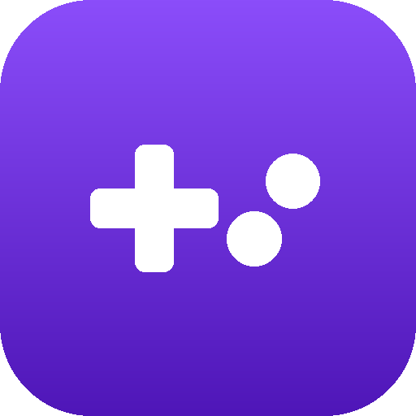
</p>

<h1 align="center">Mobilepad</h1>

<p align="center">
  Turn your Android phone into a low-latency game controller for Windows, Linux, macOS,
  Android phones, tablets and TVs, and Nintendo Switch.<br>
  USB · Wi‑Fi · Bluetooth · editable layouts and presets · game profiles · motion · macros and radial menus · skins
</p>

<p align="center">
  <a href="#download">Download</a> ·
  <a href="docs/PROTOCOL.md">Protocol</a> ·
  <a href="CONTRIBUTING.md">Contributing</a>
</p>

<p align="center">
  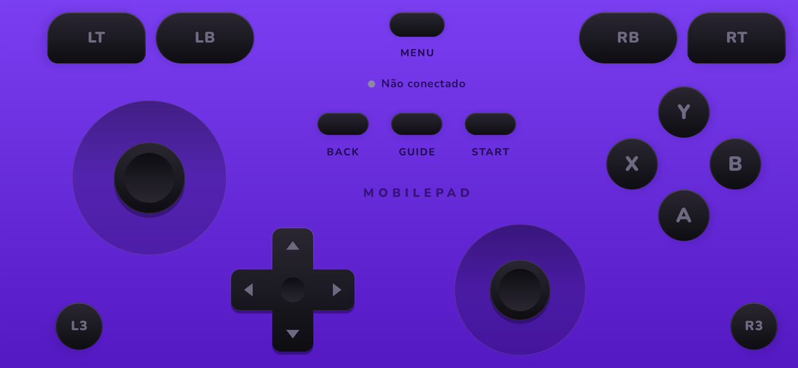
</p>

## Features

- **Three ways to connect**
  | Link | How | Host sees |
  |---|---|---|
  | USB | Companion on the PC + `adb reverse` over the cable (set up by the companion) | Xbox 360 controller |
  | Wi‑Fi | Companion (Windows/Linux) or the Switch sysmodule (Atmosphère) | Xbox 360 controller / Pro Controller |
  | Bluetooth HID | *PC · Android · TV*: generic gamepad + keyboard, no software on the host; *Switch*: Pro Controller (needs Shizuku) | Gamepad / Pro Controller |

  | Host | USB / Wi‑Fi | Bluetooth |
  |---|---|---|
  | Windows 10/11 | Companion → Xbox 360 controller (XInput, ViGEm) | Generic gamepad + keyboard |
  | Linux | Companion → Xbox 360 controller (uinput) | Generic gamepad + keyboard |
  | macOS | – | Generic gamepad + keyboard (SDL/Steam games) |
  | Android phone, tablet, Android TV, Google TV | – | Gamepad + keyboard, recognised natively |
  | Nintendo Switch | Sysmodule → Pro Controller (Atmosphère, Wi‑Fi) | Pro Controller (Shizuku) |
- **Measured latency** (Galaxy S25 → laptop, touch command → what a game reads, 2,000 presses
  each): USB cable ~5.6 ms median, Bluetooth ~9 ms median, no presses lost. Details in
  [Measured results](#measured-results).
- **Home** with a bottom dock (Connect, Controller, Motion, Extras, Settings); *Search* lists companions
  and consoles on the local network, QR code and `IP:port` still work.
- **Layout editor**: drag, resize, change the opacity of or hide any part; landscape and portrait are
  saved separately (orientation: landscape, reversed, auto-rotate or a Game Boy-style vertical
  layout). Optional floating stick that centres where the thumb lands.
- **Custom buttons**: name, icon, output and size; a button can latch after a 0.25 s hold (a tap
  stays an ordinary press), with a vibration when it locks and releases.
- **Presets**, including a ready-made **Mario Kart Wii** layout (icon buttons, latching gas pedal,
  floating stick). Two layouts at hand: swap race ⇄ menus from the quick menu or a custom swap button.
- **Skins**: built-in skins with per-button face colours, plus imported Delta skins (`.deltaskin`).
- **Button names** per console: Auto, Xbox, PlayStation (symbols in their colours) or Nintendo.
- **Game profiles** keep skin, layouts, button names, remap, macros and motion together; edits are
  saved into the active profile. The Bluetooth name the phone shows to hosts is editable.
- **Motion**: gyro/accelerometer as a Joy-Con-style motion sensor (Switch sysmodule, Bluetooth Pro
  Controller) or tilt as left-stick input (any host).
- **Macros and radial menus**, reWASD style, with a visual editor: combo triggers recorded from the
  controller (e.g. **L3 + R3**); sequences of buttons, **PC keys**, stick moves and waits, with
  optional turbo; radial menus with icons and coloured slices, chosen with a stick.
- **Physical controller passthrough**: a controller plugged into the phone is merged with the touch
  controls. **Rumble and player index** are forwarded from the game to the phone.
- **Dark and OLED black themes**; layouts adapt to phones, tablets and Android handhelds.
- **Mobilepad Lab**: latency per stage, multi-button, analog, throughput, reliability and reconnect
  tests, run from the companion ([labs/README.md](labs/README.md), see below).
- **Dolphin profiles** for the GameCube controller over USB/Wi‑Fi and Bluetooth in
  [docs/dolphin/](docs/dolphin/README.md).
- **Languages**: English, Portuguese (Brazil), Italian, Chinese (simplified and traditional) and
  Japanese; the system language is used, English otherwise.

## Screenshots

<p align="center">
  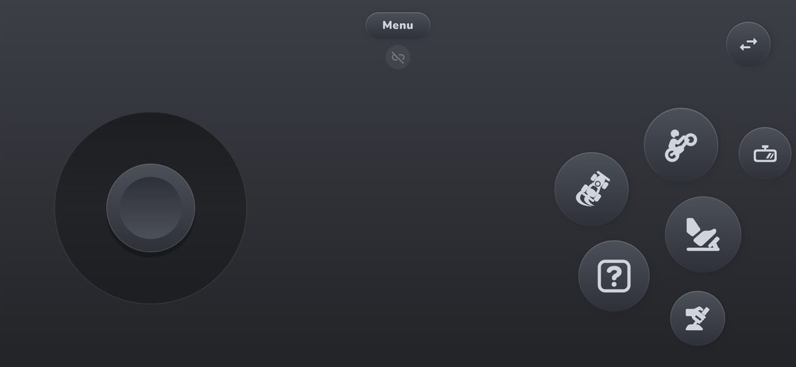
  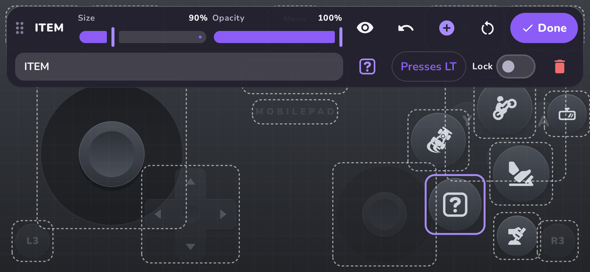
  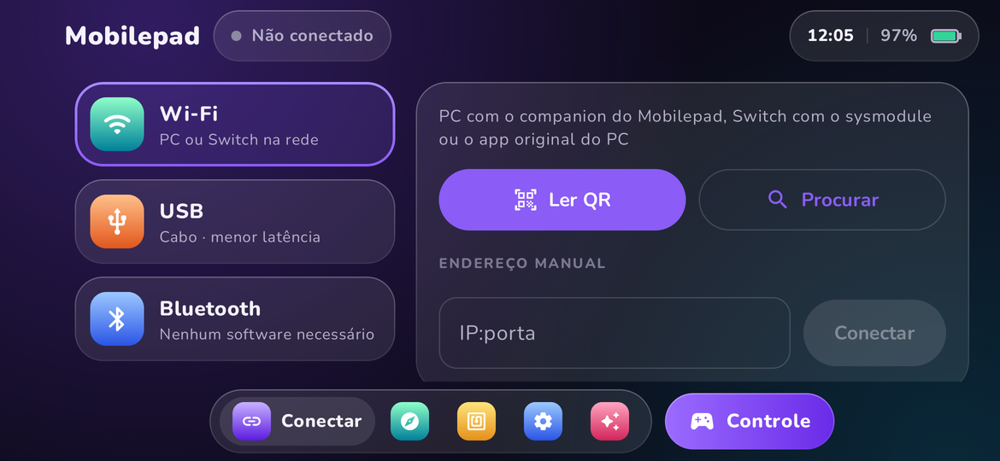
  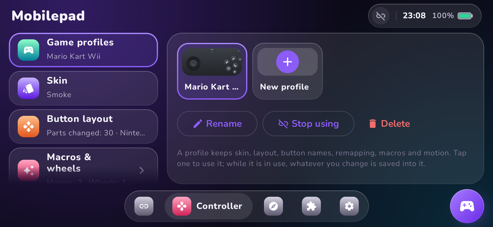
  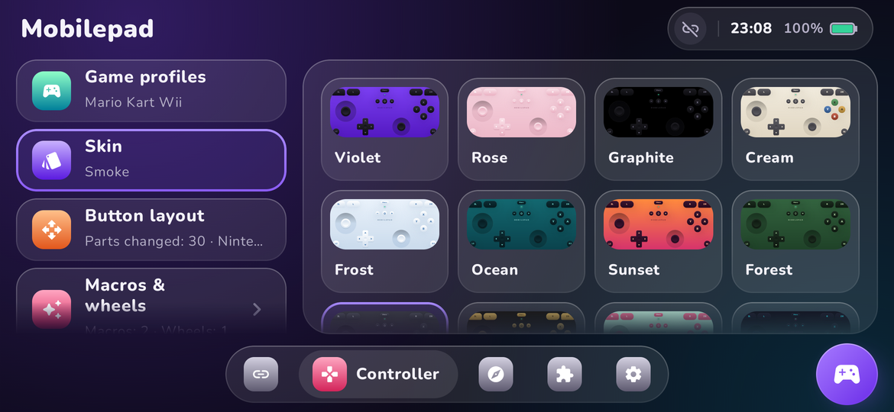
  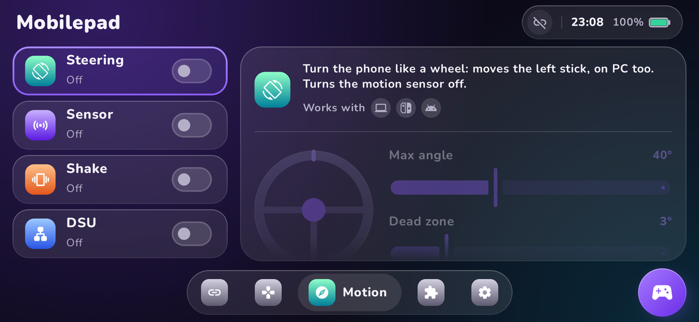
  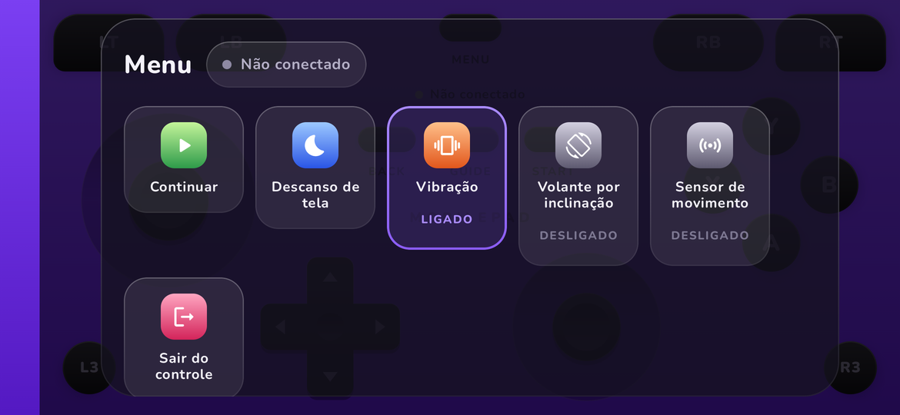
  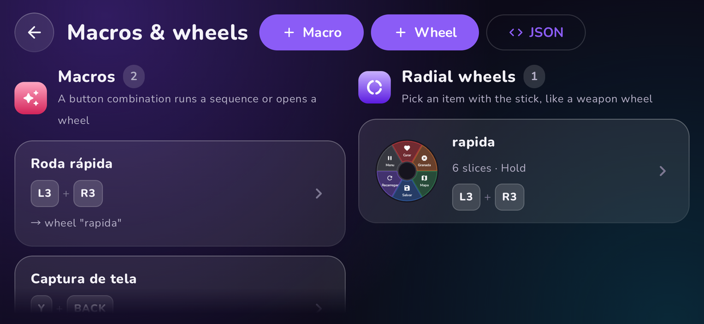
</p>

<p align="center">
  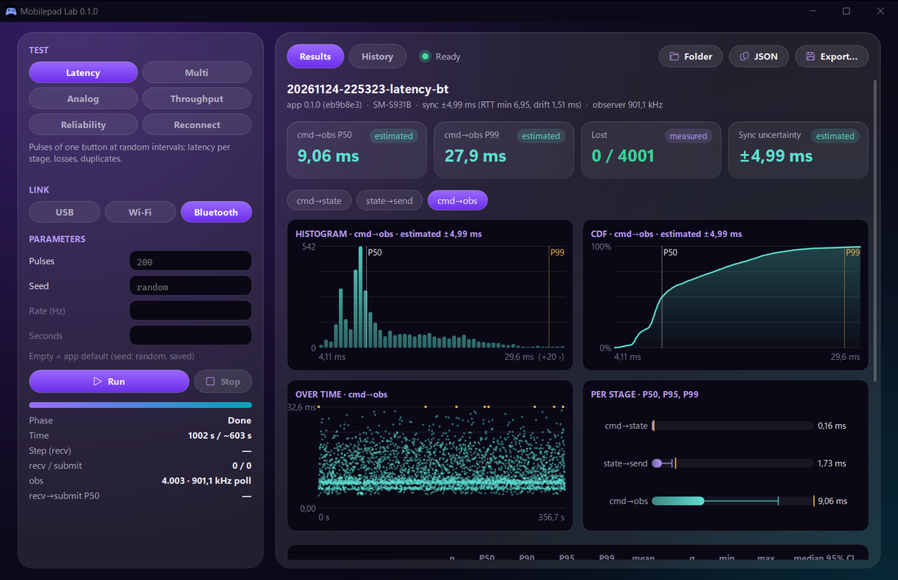
</p>

## Download

> Corrections from native speakers and new languages are welcome – see [CONTRIBUTING.md](CONTRIBUTING.md).

Get the latest builds from the [Releases](../../releases) page:

- `Mobilepad-<version>.apk` – the Android app (Android 9 or later).
- `MobilepadCompanion-<version>.exe` – the Windows companion (Windows 10/11).
- `MobilepadCompanion-<version>-linux-x64.tar.gz` / `-linux-arm64.tar.gz` – the Linux companion.
- `Mobilepad-Switch-<version>.zip` – the sysmodule for a Switch running Atmosphère.
- `Mobilepad-<version>.ipa` – unsigned iOS/iPadOS app (16+) to sideload with SideStore or AltStore:
  Wi‑Fi to companions and the Switch, touch controls and physical controllers ([ios/README.md](ios/README.md)).

## Getting started

### Windows (Wi‑Fi and USB)

1. Install the [ViGEmBus driver](https://github.com/nefarius/ViGEmBus/releases) and the
   [.NET 8 Desktop Runtime](https://dotnet.microsoft.com/download/dotnet/8.0).
2. Run `MobilepadCompanion.exe`. Allow it on private networks when Windows Firewall asks.
3. **Wi‑Fi:** in the app tap *Scan QR* and frame the code shown by the companion
   (or type `IP:47800`).
   **USB:** enable USB debugging on the phone, plug it in and tap *Connect via USB*.
   The companion needs `adb` ([Android platform-tools](https://developer.android.com/tools/releases/platform-tools))
   in `PATH` or in `C:\platform-tools`.

### Linux (Wi‑Fi and USB)

1. Extract the archive for your CPU and let your user create virtual devices (once):
   ```sh
   sudo modprobe uinput
   sudo cp 70-mobilepad-uinput.rules /etc/udev/rules.d/
   sudo udevadm control --reload && sudo udevadm trigger
   sudo usermod -aG input $USER   # then log out and back in
   ```
2. Run `./mobilepad-companion`: it prints a QR code in the terminal. Connect as on Windows
   (QR, *Search* or `IP:47800`; USB needs `adb` in `PATH`). Open TCP 47800 and UDP 47800–47801
   if a firewall is active.

Games see a wired Xbox 360 controller (same identity as the kernel `xpad` driver), with rumble.

### Nintendo Switch (Atmosphère)

1. Copy the `atmosphere` folder from `Mobilepad-Switch-<version>.zip` to the root of the SD card,
   then start *Mobilepad* from ovl-sysmodules in the Tesla menu (it does not start at boot until
   you enable that there).
2. Connect the Switch to the same Wi‑Fi as the phone. In the app tap *Search* and pick
   *Nintendo Switch* (or type `<Switch IP>:47800`; the IP is in *System Settings → Internet*).
3. A black and blue Pro Controller appears; up to four phones can connect. The buttons follow the
   Nintendo layout, by position (the bottom button is B).

#### Motion

Tap **⟲** on the controller screen: the virtual controller gets a motion sensor like a Joy-Con, fed by
the phone's accelerometer and gyroscope, so games read shakes and rotation natively (tilt steering in
Mario Kart 8 Deluxe, cap throws in Super Mario Odyssey). **⎈** is a different thing: it turns tilting the
phone into left-stick input, for games without motion controls; the two exclude each other. While the
sensor is on, two buttons pick the axis convention per game: 🏎 for Mario Kart (tilt steering) and
🎩 for Super Mario Odyssey (Cappy throws). 📳 turns the phone's vibration for the game's rumble on
or off (companions and Bluetooth; the Switch does not report rumble for virtual controllers).

#### Amiibo

With [emuiibo](https://github.com/XorTroll/emuiibo) also installed on the Switch, the app can put an
amiibo on a virtual NFC reader: tap **NFC** on the controller screen (or map the **⚡ amiibo** wheel
to any combo in the macro editor) and pick one.

- *Phone*: `.bin` dumps imported in the app's *Amiibo* section (single files, or a folder
  whose sub-folders become groups). The first time one is used, the sysmodule creates a virtual amiibo
  for it in `emuiibo/amiibo/Mobilepad/` (only its id and UID are sent; saves stay on the console).
- *Switch*: the virtual amiibo already in `sdmc:/emuiibo/amiibo`, with their folders.
- *Remove* takes the amiibo off the reader.

The first time, emuiibo emulation is switched on for you; a game that was already open has to be
restarted once (the app says so), because emuiibo only intercepts games started with emulation on.

> **No amiibo files are included or distributed.** Mobilepad only reads dumps you make yourself
> from figures you own (or virtual amiibo you already set up in emuiibo). Do not ask for, share or
> publish amiibo dumps in this project's issues or discussions.

See [switch-sysmodule/README.md](switch-sysmodule/README.md) for sleep handling, memory use and logs.
It only runs on consoles with custom firmware: on a stock Switch use the Bluetooth route below,
which needs a phone that can change its Bluetooth device class (most cannot without root).

### Bluetooth (no software on the host)

1. In the app pick *PC · Android · TV*, tap *Turn on Bluetooth*, then *Make visible*.
2. On the PC, Mac, phone or TV add a Bluetooth device and pick the phone.
3. Next time the phone reconnects by itself when the app starts.

On Android and Google TV the gamepad and keyboard work out of the box. On macOS the gamepad is
seen by SDL and Steam games; Apple's GameController framework (App Store games) only accepts
Xbox, PlayStation and Switch controllers, and macOS has no virtual Xbox driver for a companion.

While Bluetooth mode is on the app shows a "Bluetooth gamepad on" notification: Android
drops Bluetooth gamepads of apps that go to the background. If the phone was paired before with
another gamepad app, remove it from the PC and pair again: hosts cache the HID descriptor at pairing.

### Switch over Bluetooth needs Shizuku

Install and start [Shizuku](https://shizuku.rikka.app/) (wireless debugging or ADB), then tap
*Grant* in *Settings → Shizuku*: the shell confirms the pairing before the Switch gives up and gives
the phone the gamepad class of device.

## Mobilepad Lab

Measures the controller end to end: latency per stage, several buttons at once, analog axes,
throughput, reliability and reconnection, over USB, Wi‑Fi or Bluetooth. The phone stays on the USB
cable (ADB) for clock sync and triggering whatever link is tested.

- In the Windows companion click **Lab**, pick test and link, press Run; results (histogram, CDF,
  per-stage bars, metrics) are kept per app version under `%LOCALAPPDATA%\Mobilepad\lab\runs\`.
- Scripted runs: `MobilepadCompanion.exe --lab <test> <link> [count]`, with `<test>` one of
  `latency`, `multi`, `analog`, `throughput`, `reliability`, `reconnect` and `<link>` one of
  `usb`, `wifi`, `bt`.
- Spec and results: [labs/README.md](labs/README.md), [labs/SPEC.md](labs/SPEC.md),
  [labs/AUDITORIA.md](labs/AUDITORIA.md).

### Measured results

Galaxy S25 → Windows laptop, Mobilepad Lab, 2,000 presses of one button (4,001 states) per link,
from the moment the app commands the press to the moment a game reads it (XInput for USB,
Windows.Gaming.Input for Bluetooth). Phone→PC times depend on clock sync (±5 ms); times inside one
device are measured directly.

| Link | Median | P90 | P95 | P99 | Worst | Lost |
|---|---|---|---|---|---|---|
| **USB cable** (companion + virtual Xbox pad) | **5.6 ms** | 11.2 ms | 17.7 ms | 51 ms | 209 ms | 0 |
| **Bluetooth** (PC · Android · TV mode) | **9.0 ms** | 19.5 ms | 22.0 ms | 27.5 ms | 85 ms | 0 |

Where the time goes (medians):

| Stage | USB cable | Bluetooth |
|---|---|---|
| Inside the phone (command → handed to the link) | 1.3 ms | 1.9 ms |
| Link (cable via ADB / Bluetooth radio) → PC | 4.1 ms | 6.3 ms (radio → game) |
| Companion → virtual pad | 0.13 ms | — |
| Virtual pad → game | 0.06 ms | — |

- **USB cable**: the fastest link and the best median. The ADB tunnel alone is clean (3,000 round
  trips: median 2.7 ms, worst 8.6 ms), so the rarer spikes in the table come from the laptop being
  busy (other apps, a video playing doubled them), not from the cable; still being investigated.
- **Bluetooth**: about 60% of presses arrive in 2–8 ms; the rest wait for the next radio window
  when the link has been idle (Bluetooth power saving), up to ~25 ms. Turning the phone's Wi‑Fi off
  made no difference.
- For reference, one frame at 60 fps is 16.7 ms.

## Compatibility with Remote Gamepad

Over Wi‑Fi the app also works with the PC app of *Remote Gamepad* by SmartFusionLabs: scan its QR
code. PC keys from macros are only delivered by the Mobilepad Companion or over Bluetooth.
Mobilepad is an independent project, not affiliated with SmartFusionLabs; compatibility comes from
an independent analysis of the network protocol, documented in [docs/PROTOCOL.md](docs/PROTOCOL.md).

## Building from source

| Part | Requirements | Command |
|---|---|---|
| Android app | JDK 17+, Android SDK (platform 36) | `cd android && ./gradlew assembleRelease` |
| Unit tests | same | `cd android && ./gradlew testDebugUnitTest` |
| Windows companion | .NET 8 SDK | `cd pc-companion/Windows && dotnet publish -c Release -r win-x64 --self-contained false -p:PublishSingleFile=true -o ../publish/win-x64` |
| Linux companion | .NET 8 SDK | `cd pc-companion/Linux && dotnet publish -c Release -r linux-x64 --self-contained -p:PublishSingleFile=true -o ../publish/linux-x64` |
| iOS app | macOS, Xcode 15+, XcodeGen | `cd ios && xcodegen generate` (see [ios/README.md](ios/README.md)) |
| Switch sysmodule | [devkitPro](https://devkitpro.org/wiki/Getting_Started) `switch-dev` | `cd switch-sysmodule && make dist` |

Release APKs are signed with the key described in `android/keystore.properties`
(`storeFile`, `storePassword`, `keyAlias`, `keyPassword`); without it the debug key is used.
See [CONTRIBUTING.md](CONTRIBUTING.md) for details.

## Project layout

```
android/          Android app (Kotlin, Jetpack Compose)
pc-companion/     PC companion (C#, .NET 8)
  Core/           shared protocol, sessions, discovery, ADB
  Windows/        WinForms app, ViGEmBus pad, SendInput keyboard, Lab screen
  Linux/          console app, uinput pad and keyboard
switch-sysmodule/ Atmosphère sysmodule (C, libnx): virtual Pro Controller over Wi‑Fi
ios/              iPhone/iPad app (SwiftUI), Wi‑Fi only
labs/             Mobilepad Lab: spec, audit and results
docs/             Protocol specification, images, Dolphin profiles
tools/            Helper scripts
```

## Credits

- [ViGEmBus / ViGEm.Client](https://github.com/nefarius/ViGEmBus) (MIT/BSD‑3) – virtual Xbox controller.
- [Shizuku](https://github.com/RikkaApps/Shizuku-API) (Apache‑2.0) and
  [HiddenApiBypass](https://github.com/LSPosed/AndroidHiddenApiBypass) (Apache‑2.0) – Bluetooth calls for the Switch.
- [ZXing Android Embedded](https://github.com/journeyapps/zxing-android-embedded) (Apache‑2.0) – QR scanner.
- [QRCoder](https://github.com/codebude/QRCoder) (MIT) – QR code in the companion.
- [emuiibo](https://github.com/XorTroll/emuiibo) (used through its IPC service, not bundled) –
  amiibo emulation on the Switch.
- [libnx](https://github.com/switchbrew/libnx) (ISC) – Switch sysmodule; the HDLS virtual controller
  approach is the one used by [sys-botbase](https://github.com/olliz0r/sys-botbase) and
  [MissionControl](https://github.com/ndeadly/MissionControl).

Mobilepad was developed by pedropasinn with the help of AI tools, including Anthropic's Claude.

## License

[MIT](LICENSE) for the code. The license does not cover the Mobilepad name and logo.
Nintendo Switch, Joy-Con and amiibo are trademarks of Nintendo; Xbox is a trademark of Microsoft;
other names belong to their owners. Mobilepad is not affiliated with or endorsed by them.
